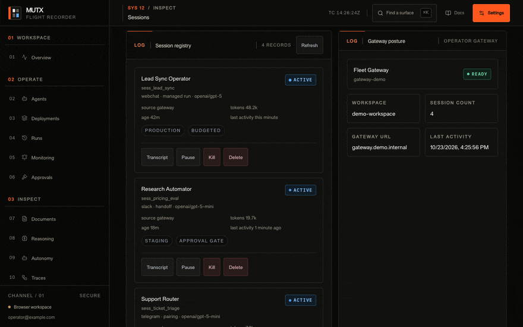
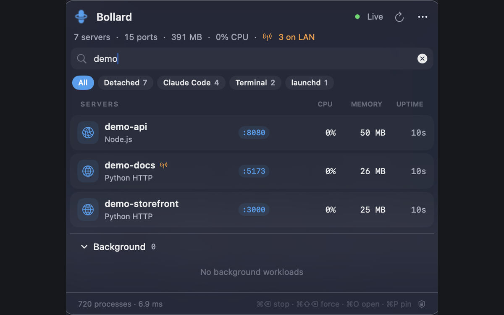
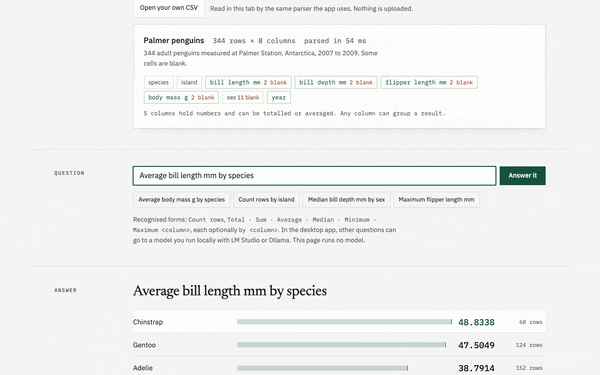
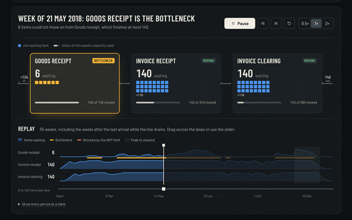
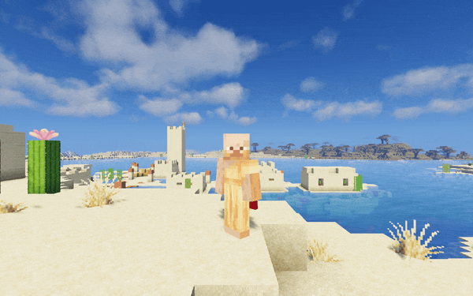
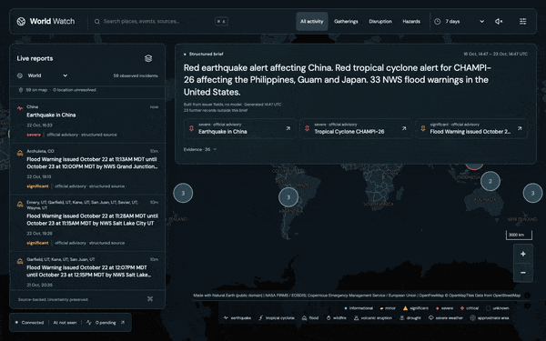
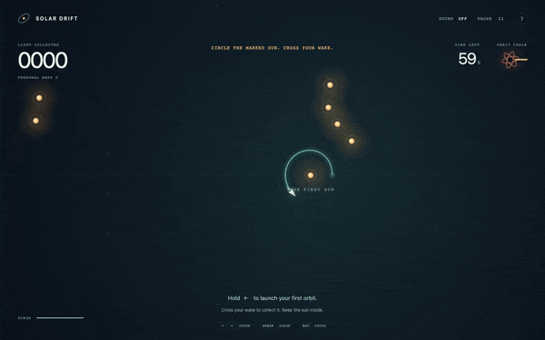
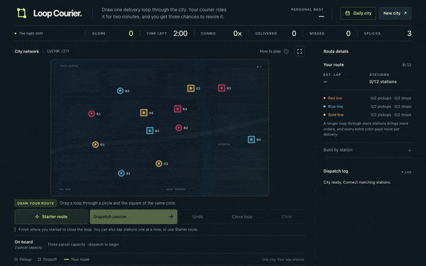
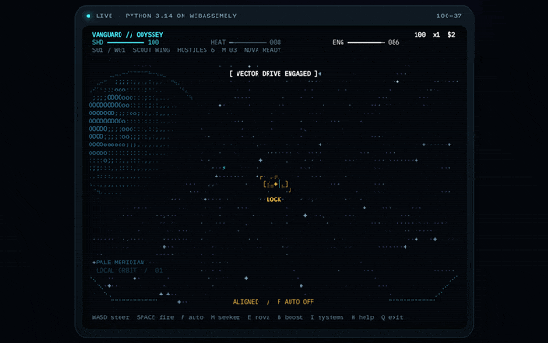
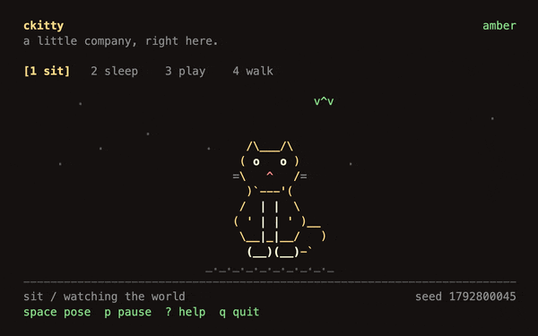

# fortunexbt

I build the software I (and maybe, you) need: an agent control plane, a Mac menu bar app, local-first data & LLM tooling, and games for the browser and the terminal.

**[MUTX](https://github.com/mutx-dev/mutx-dev)** is a control plane for AI agents. Operators deploy agents, watch every run, set budgets and approval rules, and stop any run. FastAPI, Next.js, a macOS app, a CLI and a Python SDK: 249 API route handlers and 3,336 tests. [Docs](https://docs.mutx.dev/)

<table>
<tr>
<td width="50%" valign="top">

 <b><a href="https://github.com/fortunexbt/bollard">Bollard</a></b>
 Every server on your Mac in the menu bar, named by project and git branch, with a Stop button that works. SwiftUI and a small C bridge over Darwin's kernel tables.
 <code>brew install --cask fortunexbt/tap/bollard</code>
</td>
<td width="50%" valign="top">

 <b><a href="https://github.com/fortunexbt/tablebeam">Tablebeam</a></b>
 Ask a spreadsheet a question and get the exact answer with the rows it used. The arithmetic runs in exact decimals, no model required.
 <a href="https://tablebeam-eight.vercel.app/">Try it</a> · <a href="https://github.com/fortunexbt/tablebeam">Code</a>
</td>
</tr>
<tr>
<td width="50%" valign="top">

 <b><a href="https://github.com/fortunexbt/boundary-bench">BoundaryBench</a></b>
 Crash tests for agent controls. Does the agent stop when told, stay under budget, wait for approval? The server keeps the score.
 <a href="https://fortunexbt.github.io/boundary-bench/">Report</a> · <a href="https://github.com/fortunexbt/boundary-bench">Code</a>
</td>
<td width="50%" valign="top">

 <b><a href="https://github.com/fortunexbt/queueglass">Queueglass</a></b>
 Watch a queue back up under load and recover. Seeded, so a link replays the exact run.
 <a href="https://queueglass.vercel.app/">Try it</a> · <a href="https://github.com/fortunexbt/queueglass">Code</a>
</td>
</tr>
<tr>
<td width="50%" valign="top">

 <b><a href="https://github.com/fortunexbt/minecraft-apple-silicon-framework">Minecraft on Apple silicon</a></b>
 Shader setups for M-series Macs, each measured over the same scripted flight, with a CLI that tries one and rolls it back.
 <a href="https://fortunexbt.github.io/minecraft-apple-silicon-framework/">Browse</a> · <a href="https://github.com/fortunexbt/minecraft-apple-silicon-framework">Code</a>
</td>
<td width="50%" valign="top">

 <b><a href="https://github.com/fortunexbt/world-watch">World Watch</a></b>
 Earthquakes, disaster alerts, storms and fires on one live map, every marker linked to its public record.
 <a href="https://github.com/fortunexbt/world-watch">Code</a>
</td>
</tr>
<tr>
<td width="50%" valign="top">

 <b><a href="https://github.com/fortunexbt/solar-drift">Solar Drift</a></b>
 Loop around a sun and cross your own wake to capture it. Canvas and procedural audio, nothing to install.
 <a href="https://fortunexbt.github.io/solar-drift/">Play</a> · <a href="https://github.com/fortunexbt/solar-drift">Code</a>
</td>
<td width="50%" valign="top">

 <b><a href="https://github.com/fortunexbt/loop-courier">Loop Courier</a></b>
 Draw one route through a seeded city and make every deadline. A new city every midnight.
 <a href="https://fortunexbt.github.io/loop-courier/">Play</a> · <a href="https://github.com/fortunexbt/loop-courier">Code</a>
</td>
</tr>
<tr>
<td width="50%" valign="top">

 <b><a href="https://github.com/fortunexbt/terminal-starfield">Terminal Starfield</a></b>
 A space-combat roguelite for the terminal in pure Python. The browser version runs the same code on Pyodide.
 <a href="https://terminal-starfield.vercel.app/">Play</a> · <a href="https://github.com/fortunexbt/terminal-starfield">Code</a>
</td>
<td width="50%" valign="top">

 <b><a href="https://github.com/fortunexbt/ckitty">ckitty</a></b>
 A cat for your terminal, written in C. The browser version is the same code in 65 KB of WebAssembly.
 <a href="https://ckitty.vercel.app/">Play</a> · <a href="https://github.com/fortunexbt/ckitty">Code</a>
</td>
</tr>
</table>

### Things I measured

- pandas, SQLite and DuckDB silently returned wrong totals on 12-17% of real Wikipedia-table questions. Tablebeam: 0.4%. [Eval](https://github.com/fortunexbt/tablebeam/tree/f141ee739f/eval)
- Claude Code kept calling write tools after the server said the budget was spent, in 5 of 5 runs. [Traces](https://github.com/fortunexbt/boundary-bench/tree/e937412/runs/2026-10-23-claude-code-haiku)
- Coding agents fell into loops of failing tool calls in 8.2% of 7,903 real sessions.
- A rule-based prompt-injection filter caught 0 of 320 attacks it was not written for.

Data, limits and the command that reproduces each one are on [fortunexbt.com](https://fortunexbt.com/#findings). Merged upstream: [google/adk-js#952](https://github.com/google/adk-js/pull/952).

[fortunexbt.com](https://fortunexbt.com) · [X](https://x.com/fortunexbt) · [Telegram](https://t.me/fortunexbt)
